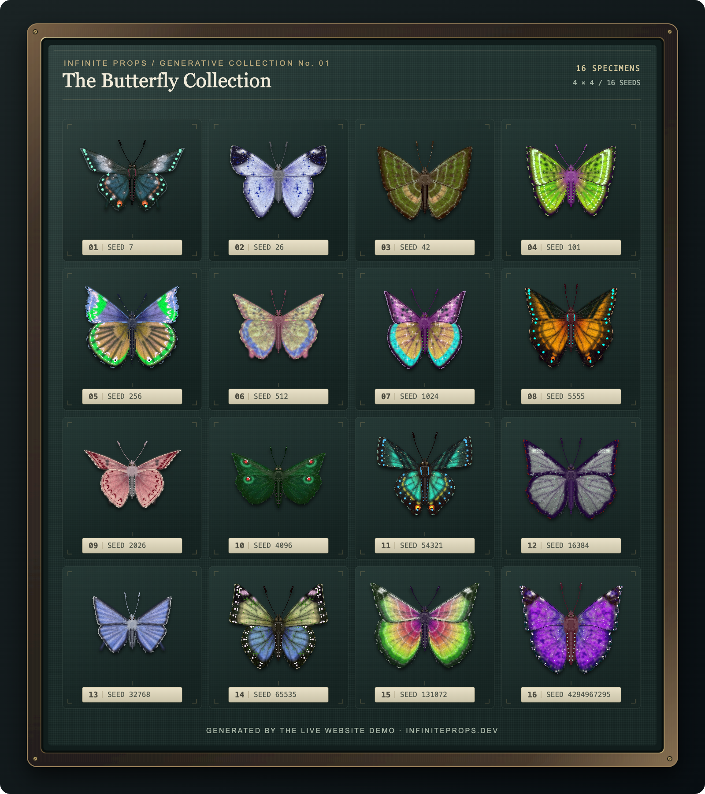

<h1 align="center">
  <a href="https://infiniteprops.dev/">
    
  </a>
</h1>

<h2 align="center"><a href="https://infiniteprops.dev/">🌐 infiniteprops.dev ↗</a></h2>

<p align="center">
  <strong>Roll a forest. Forge an arsenal. Populate a world.</strong><br>
  A language, portable format and runtime for seed-based procedural 2D assets.
</p>

<p align="center">
  <a href="https://infiniteprops.dev/#butterfly-benchmark"><strong>Try it live</strong></a> ·
  <a href="#quick-start">Quick start</a> ·
  <a href="docs/language/index.md">Language handbook</a> ·
  <a href="#bring-it-to-your-engine">Integrations</a> ·
  <a href="CHANGELOG.md">What's new</a>
</p>

<p align="center">
  <a href="examples/showcase/readme-collection.png">
    
  </a>
</p>

<p align="center">
  <strong>Three procedural parts. Sixteen seeds. A whole collection.</strong><br>
  <sub>The original website butterflies, generated with its WASM worker.<br>
  Forewings, hindwings and a body, assembled and mirrored just like the live demo.</sub>
</p>

## One recipe. A world of variation.

Describe a sword, tree, rock or crate once. Then explore its shapes, materials
and details through seeds and inputs. **You set the art direction. The recipe
does the rolling.**

Write the rules in `.ips`, compile them into a self-contained `.iprop`, and
generate **RGBA images and named geometry** in your game, browser or asset
pipeline. A 32-bit seed gives you **4,294,967,296 reproducible starting points**.
The recipe decides what varies.

| Write the recipe | Pack the possibilities | Generate on demand |
| :--- | :--- | :--- |
| **`.ips`** — shapes, materials, inputs and variation. | **`.iprop`** — one portable compiled program. | **Seed + inputs → pixels + geometry.** |

### Built for worlds that need more than one of everything

- **A collection from one design.** Grow forests, vary scenery and roll
  equipment while keeping a consistent style.
- **Randomness with direction.** Use distributions, palettes and material
  ramps to control proportions, color families and rare details.
- **Save the seed. Keep the prop.** The same program, seed, dimensions and
  inputs reproduce the same RGBA bytes and geometry bits on every conforming
  backend.
- **Pixels with a purpose.** Generate colliders, bounds and attachment points
  alongside the image, from the same shape calculations.
- **Your engine, your pipeline.** Bring the same compiled recipe to native
  code, the web, desktop and mobile integrations.

## Quick start

Build from the repository root with CMake 3.24+, a C++20/C99 toolchain and
zlib 1.2.9+. Python 3.10+ enables generated documentation. Tests fetch Catch2
by default; optional native backends build when their dependencies are available.

```sh
cmake -S . -B build -DCMAKE_BUILD_TYPE=Release
cmake --build build --parallel

build/tools/ipc examples/language/first-asset.ips -o build/first-asset.iprop
build/tools/ipval build/first-asset.iprop
build/tools/ipgen build/first-asset.iprop --seed 7 -o build/first-asset.png
```

**That's the loop: write → compile → generate.** Change the seed or declared
inputs to explore another variation.

Installed SDKs put the tools in `bin/` and documentation/examples under
`share/iprop/`. Windows tool names add `.exe`. See [building](docs/building.md)
for dependencies, optional integrations, tests and installation.

## Small recipe. Real control.

A stone with a color input, seed-driven proportions and a collider derived
from its shape:

```ips
asset stone {
  size 32x32
  input color tint = #8a9299
  output rect collider
  draw {
    w = 18 to 26
    h = 14 to 22
    x = (32.0 - float(w)) * 0.5
    y = 28.0 - float(h)
    oval(16, y + float(h) * 0.5, float(w) * 0.5, float(h) * 0.5, tint)
    collider = {x, y, float(w), float(h)}
  }
}
```

`to` sets the variation. `tint` exposes a choice to your game or tools.
`collider` carries the shape into gameplay.

Ready for more? [Samplers](docs/language/samplers.md) capture ranges for
explicit sampling; [steppers](docs/language/steppers.md) produce deterministic
batches without consuming RNG. [Parts](docs/language/composition.md) let you
assemble larger props with isolated random streams.

## Bring it to your engine

Use the same `.iprop` program, seed and inputs across integrations.

| Target | Integration |
| :--- | :--- |
| **Browser** | [HTML5 / WebAssembly](backends/html5/README.md) |
| **Unity** | [C# package and native plugin](backends/unity/README.md) |
| **Godot** | [GDExtension](backends/godot/README.md) |
| **C / C++** | [C API](backends/capi/README.md) · [SFML](backends/sfml/README.md) |
| **Apple platforms** | [Swift](backends/apple/README.md) |
| **Android** | [Kotlin](backends/android/README.md) |
| **Python** | [Python bindings](backends/python/README.md) |

The [native binding contract](docs/native-bindings.md) documents the shared
behavior of the Apple, Unity, Android and Python integrations.

## A small language with a full toolbox

| Build | Shape | Finish |
| :--- | :--- | :--- |
| Raster primitives, curves, vectors and distance fields. | Noise, palettes, gradients and color utilities. | RGBA layers, masks, clipping, morphology and blur. |
| Typed constants, immutable lists and distributions. | Nested parts, isolated RNG and exact D4 transforms. | Named geometry, validated bytecode and bounded generation. |

The toolchain takes you through the whole loop: **compile, assemble, validate,
disassemble, render and compare seeds**. The [VS Code extension](editor/README.md)
brings the language into your editor.

## Keep exploring

| Start here | Go deeper |
| :--- | :--- |
| [Language handbook](docs/language/index.md) | [Format and VM specification](spec/iprop-v0.8.md) |
| [Example recipes](examples/recipes/README.md) | [C API and ABI policy](docs/c-api-abi.md) |
| [Compact LLM reference](docs/llm-reference.md) | [Export contracts](docs/export-contracts.md) |
| [Building and installation](docs/building.md) | [CI and publication](docs/ci.md) |
| [Website build](website/README.md) | [Changelog](CHANGELOG.md) |

**Product 0.8.0 · Source language 0.8.0.** The compiler and runtime use an
**unversioned** file format; C API **0.4** uses ABI / SONAME **0.5**.
New in 0.8: reusable [materials](docs/language/materials.md) with private
libraries, typed helper parameters and named overrides. See the
[material tree example](examples/language/material-tree.ips),
[0.7 to 0.8 migration](docs/language/migration-v0.8.md) and
[release preparation guide](docs/release-v0.8.md).
Coming from 0.6? Start with the [0.7 migration](docs/language/migration-v0.7.md).

## License

Infinite Props is licensed in parts; [LICENSE](LICENSE) maps every directory
to its license and [licenses/](licenses/) holds the full texts.

- **Runtime** (`runtime/` and `backends/`, including all language and engine
  integrations): [MPL-2.0](licenses/MPL-2.0.txt). Embed it in any game or engine,
  commercial or closed; changes to these files stay open when distributed.
- **Toolchain** (`compiler/`, `language/`, `tools/`, `editor/`, `scripts/`,
  `tests/`, `benchmarks/`, `website/`): [FSL-1.1-ALv2](licenses/FSL-1.1-ALv2.md).
  Use it for anything, including commercial games, except offering it or a
  substitute to others as a competing product or service. Each version
  becomes Apache-2.0 two years after its release.
- **Documentation and open examples** (`docs/`, `spec/`, `examples/`):
  [CC-BY-4.0](licenses/CC-BY-4.0.txt).
- **Showcase props** (`examples/showcase/`) and images rendered from them,
  including the butterfly collection above: all rights reserved, see
  [their license](examples/showcase/LICENSE.md). The native SDK includes the
  README preview and its notice; the compiled showcase programs are excluded.

The `.ips` programs you write, the `.iprop` files compiled from them and
everything they generate are yours. "Infinite Props" and its logo are
trademarks; the licenses grant no right to use them.

<p align="center">
  <strong>Have a world in mind? Give it a recipe.</strong><br>
  <a href="https://infiniteprops.dev/"><strong>Explore Infinite Props ↗</strong></a>
</p>
